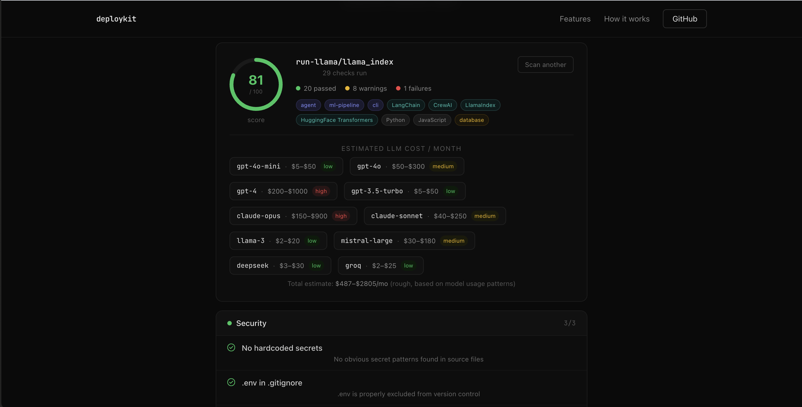
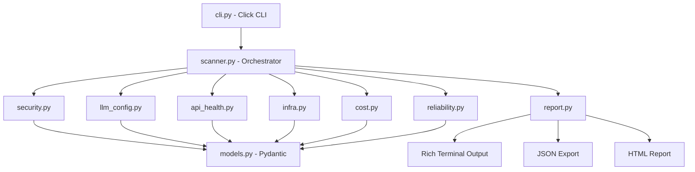

# deploykit

[](https://github.com/mansi/deploykit/actions/workflows/ci.yml)
[](https://www.python.org/downloads/)
[](https://opensource.org/licenses/MIT)

Production readiness scanner for AI applications. One command to find security holes, missing infrastructure, and costly LLM misconfigurations before they hit production.

**Live demo:** [deploykit.vercel.app](https://deploykit.vercel.app) — paste any public GitHub repo URL and get an instant production readiness report.

<p align="center">
  
</p>

## Why this exists

Shipping an AI application to production involves more than getting the model calls right. Teams routinely forget to:

- Remove hardcoded API keys before pushing to a public repo
- Add timeouts and retries to LLM calls that hang under load
- Set up health endpoints, rate limiting, and CORS
- Estimate what their monthly LLM bill will actually look like
- Configure logging and monitoring for a service that depends on external APIs

deploykit scans your project directory and generates a production readiness report across six categories, so you can fix these gaps before your users find them.

## Quick start

```bash
pip install deploykit
```

Scan a project:

```bash
deploykit scan ./my-ai-app
```

Export as JSON for CI pipelines:

```bash
deploykit scan ./my-ai-app --format json -o report.json
```

Generate an HTML report:

```bash
deploykit scan ./my-ai-app --format html -o report.html
```

Fail CI if the score is below a threshold:

```bash
deploykit scan ./my-ai-app --fail-under 70
```

## Example output

```
 deploykit Production Readiness Report

 Project: my-ai-app
 Path:    /home/user/my-ai-app
 Score:   62.5/100

 Security (2/4 passed)
 Status  Check                     Details                           File
 PASS    hardcoded_secret          No hardcoded secrets detected
 FAIL    env_in_gitignore          .env files exist but not ignored
 PASS    env_has_real_secrets      No real secrets in .env files
 WARN    debug_mode_enabled        DEBUG=True found                  settings.py:3

 Top Recommendations:
  ! Add '.env' to your .gitignore to prevent committing secrets.
  * Use environment-specific configuration to disable debug mode in production.
```

## Check reference

| Category        | Check                     | Severity | What it looks for                                     |
|-----------------|---------------------------|----------|-------------------------------------------------------|
| Security        | hardcoded_secret          | FAIL     | API keys (OpenAI, AWS, GitHub, etc.) in source code   |
| Security        | env_in_gitignore          | FAIL     | .env files not listed in .gitignore                   |
| Security        | env_has_real_secrets      | WARN     | Real secret values inside .env files                  |
| Security        | debug_mode_enabled        | WARN     | DEBUG=True in settings or config files                |
| LLM Config      | llm_timeout               | WARN     | LLM client without timeout parameter                  |
| LLM Config      | llm_retry_logic           | WARN     | LLM calls without retry/error handling                |
| LLM Config      | hardcoded_model_name      | WARN     | Model names as string literals instead of env vars    |
| LLM Config      | llm_streaming             | WARN     | No streaming configured for LLM calls                 |
| LLM Config      | llm_fallback              | WARN     | No fallback model configuration                       |
| API Health      | health_endpoint           | WARN     | Missing /health or /healthz endpoint                  |
| API Health      | cors_config               | WARN     | No CORS middleware configured                          |
| API Health      | rate_limiting             | WARN     | No rate limiting middleware                            |
| API Health      | error_handlers            | WARN     | No global exception/error handler                      |
| Infrastructure  | dockerfile                | WARN     | No Dockerfile or deployment config                     |
| Infrastructure  | gitignore                 | FAIL     | Missing or incomplete .gitignore                       |
| Infrastructure  | cicd                      | WARN     | No CI/CD pipeline configuration                        |
| Infrastructure  | dependency_management     | WARN     | No package manager config file                         |
| Infrastructure  | readme                    | WARN     | No README file                                         |
| Cost            | detected_models           | PASS     | Lists detected LLM models                             |
| Cost            | expensive_model           | WARN     | High-tier models without caching                       |
| Cost            | llm_caching               | WARN     | No response caching for LLM calls                      |
| Cost            | cost_estimate             | WARN     | Monthly cost estimate exceeds thresholds               |
| Reliability     | logging_setup             | WARN     | No logging library configured                          |
| Reliability     | structured_logging        | WARN     | No structured (JSON) logging                           |
| Reliability     | monitoring                | WARN     | No observability tooling (Sentry, OTel, etc.)         |
| Reliability     | graceful_shutdown         | WARN     | No SIGTERM/SIGINT signal handlers                      |

## Architecture



The scanner walks the target directory, skipping common non-source directories (`node_modules`, `.git`, `__pycache__`). Each check module receives the project path and returns a list of `CheckResult` objects. The scanner aggregates results, computes a weighted score, and passes everything to the report renderer.

## Scoring

Each check result is weighted equally:
- **PASS** = 100 points
- **WARN** = 50 points
- **FAIL** = 0 points

The final score is the average across all checks, normalized to 0-100.

## Contributing

```bash
git clone https://github.com/mansi/deploykit.git
cd deploykit
pip install -e ".[dev]"
pytest -v
```

To add a new check:

1. Create a function in the appropriate check module (or create a new one in `deploykit/checks/`)
2. Return a list of `CheckResult` objects
3. Register it in `deploykit/checks/__init__.py`
4. Add tests in `tests/`

## License

MIT
